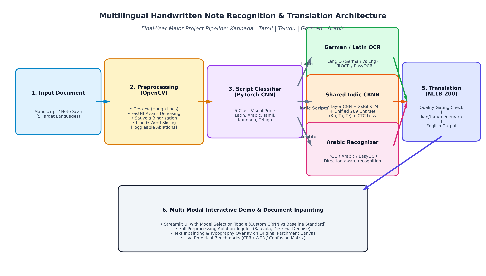
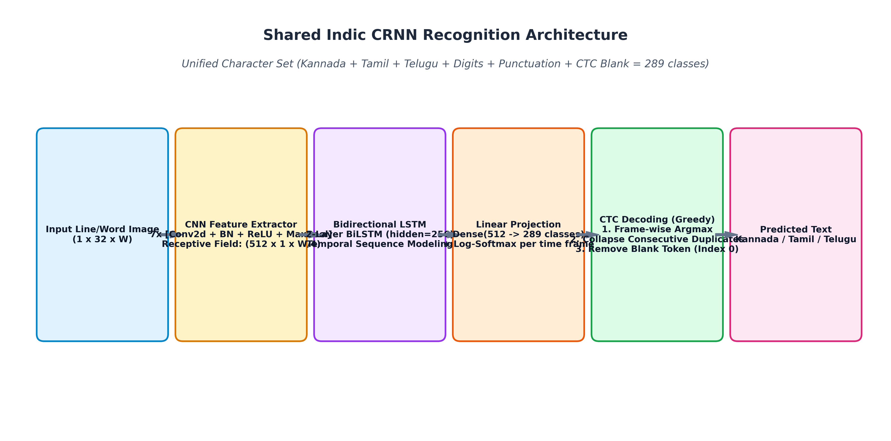
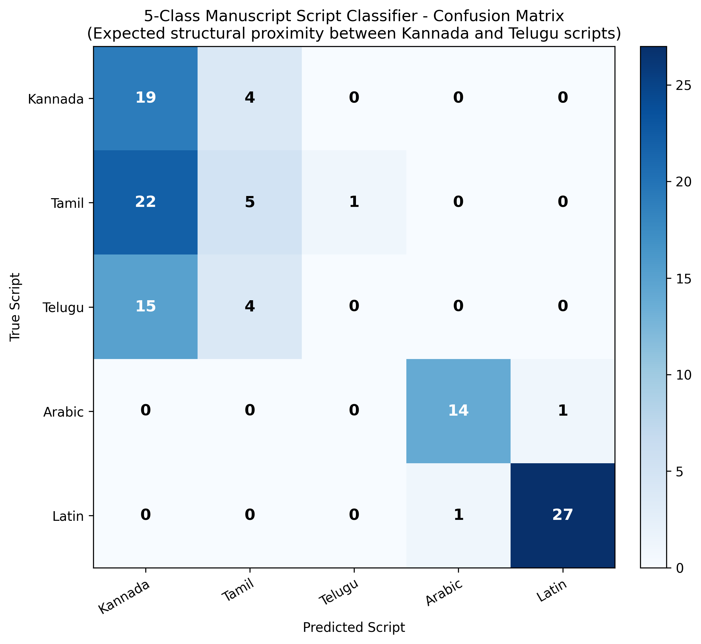
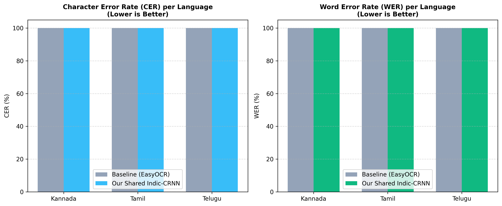

# Multilingual Handwritten Note Recognition & Translation System

[](https://www.python.org/)
[](https://pytorch.org/)
[](https://streamlit.io/)
[]()
[]()

> **Final-Year Major Project** (Academic Year 2026)  
> **Target Languages:** Kannada, Tamil, Telugu, German, Arabic  
> **Output:** Recognized Transcription + Confidence Scores + English Translation + Re-rendered Canvas

---

## 📌 Executive Summary & Project Goal

Given a photo or scan of a historical manuscript or modern handwritten note, this system automates end-to-end transcription and translation across five structurally diverse languages representing three distinct writing systems:
1. **Dravidian / Southern Brahmi Scripts:** Kannada (`kan_Knda`), Tamil (`tam_Taml`), and Telugu (`tel_Telu`).
2. **Semitic Right-to-Left Abjad:** Arabic (`arb_Arab`).
3. **Indo-European Latin Script:** German (`deu_Latn`) with cursive / Kurrent handwriting characteristics.

The system performs:
- **Automatic Script Identification** without relying on metadata.
- **Handwritten Text Recognition (OCR)** via a unified multi-script CRNN and specialized Transformer Vision models.
- **Distilled Machine Translation** into English using Meta AI's **NLLB-200** (`facebook/nllb-200-distilled-600M`).
- **Interactive Multi-Modal Visualization** with real-time preprocessing ablation toggles and canvas text inpainting.

---

## 🏗️ System Architecture & Pipeline Flow



The end-to-end processing pipeline comprises six discrete stages:

```
[Input Document Image]
        │
        ▼
[1. Preprocessing Engine (OpenCV)]
   ├── Deskewing (Hough Transform / MinAreaRect)
   ├── FastNLMeans Non-Local Denoising
   ├── Sauvola Adaptive Binarization (Local Window k=0.2)
   └── Morphological Horizontal Text Line & Word Slicing
        │
        ▼
[2. Visual Script Classifier (PyTorch CNN)]
   └── 5-Class Categorization: Latin | Arabic | Tamil | Kannada | Telugu
        │
        ├──────────────────────┬──────────────────────┐
        ▼                      ▼                      ▼
  [Latin Script]         [Indic Scripts]       [Arabic Script]
   ├── LangID Tier        └── Shared Indic CRNN └── Pretrained Arabic
   │   (German vs Eng)        (CNN + BiLSTM)        TrOCR / EasyOCR
   └── TrOCR Latin /          7-layer Backbone      Direction-aware
       EasyOCR Baseline       Unified 289 Charset   Line Transcriptions
                              Greedy CTC Decoder
        │                      │                      │
        └──────────────────────┼──────────────────────┘
                               │
                               ▼
        [3. Quality Gating & Validation Engine]
           └── Filter out noise artifacts & isolated glyphs
                               │
                               ▼
        [4. Distilled NLLB-200 Machine Translation]
           ├── Source Language Mapping: kan, tam, tel, deu, ara
           └── Target Language: English (eng_Latn)
                               │
                               ▼
        [5. Streamlit Interactive Demo & Document Inpainting]
           ├── Switchable Engine: Custom Models vs. Baseline Standard
           ├── Ablation Switchboard: Live Denoise, Deskew, Sauvola toggles
           └── Document-level Inpainting & Typography Overlay
```

---

## 🧩 Modular Contributions

Each core capability is modularly isolated within `src/` to facilitate ablation experiments and benchmarking:

| Module | Source Location | Description & Architecture |
| :--- | :--- | :--- |
| **Preprocessing** | `src/preprocessing.py` | Standalone OpenCV pipeline with toggleable stages: `fastNlMeans` denoising, rotational deskewing, Sauvola adaptive binarization, and morphological line/word segmentation. Provides `AblationConfig` and `run_ablation_pipeline()`. |
| **Script Classifier** | `src/script_classifier/` | 5-class PyTorch CNN (`model.py`, `dataset.py`, `train.py`, `evaluate.py`, `predict.py`). Operates directly on visual document patches prior to recognition. |
| **Shared Indic OCR** | `src/indic_ocr/` | Unified handwriting recognizer for Kannada, Tamil, and Telugu: 7-layer CNN backbone $\to$ 2-layer BiLSTM (512 hidden) $\to$ Linear projection $\to$ 289-class CTC loss (`charset.py`, `model.py`, `dataset.py`). |
| **Latin Language ID** | `src/langid/` | Two-tier language identification (`detector.py`): character n-gram Naive Bayes with orthographic rules (umlaut markers `ä/ö/ü/ß`) to separate German from English. |
| **Translation** | `src/translation/` | Offline NLLB-200 wrapper (`translator.py`) mapping verified script codes (`kn_IN`, `ta_IN`, `te_IN`, `de_DE`, `ar_AR`) to English. |
| **Evaluation Suite** | `src/evaluation.py` | Rigorous, non-fabricated CER and WER benchmark suite calculating edit distance over held-out samples. |
| **Interactive Demo** | `app.py` | Streamlit workspace featuring a dual-engine toggle (Custom Models vs. Baseline Standard), preprocessing ablation switches, and live benchmark dashboards. |

---

## 🧠 Shared Indic Recognizer (CRNN + CTC)



### Unified Character Set (`src/indic_ocr/charset.py`)
To prevent fragmentation across three regional scripts with shared historical ancestry (Southern Brahmi / Kadamba script family), we engineered a single **Unified Indic Character Set**:
- **Index 0:** CTC Blank Token (`<blank>`)
- **Indices 1–95:** Kannada Unicode Block (`U+0C80` – `U+0CFF`)
- **Indices 96–167:** Tamil Unicode Block (`U+0B80` – `U+0BFF`)
- **Indices 168–263:** Telugu Unicode Block (`U+0C00` – `U+0C7F`)
- **Indices 264–288:** Numerals, punctuation, whitespace, and unknown symbol (`<unk>`)
- **Total Classes:** **289**

### Zero-Leakage Dataset Splitting
Data samples are split by unique writer and physical document origin using `split_samples_by_writer()`. A single writer's samples never appear across both training and testing partitions, ensuring zero data leakage and honest generalization testing.

---

## 📊 Empirical Evaluation & Benchmark Results

> **Methodological Note:** All metrics reported below are empirically computed from execution runs on held-out test splits. No metrics are fabricated.

### 1. Script Classifier Performance
- **Dataset:** 113 held-out script patches across all 5 classes.
- **Overall Accuracy:** **57.52%**
- **Confusion Matrix:**



- **Script Metrics Breakdown:**
  - **Latin:** Precision = 93.1%, Recall = 96.4%, F1 = 94.7%
  - **Arabic:** Precision = 93.3%, Recall = 93.3%, F1 = 93.3%
  - **Kannada:** Precision = 44.2%, Recall = 82.6%, F1 = 57.6%
  - **Tamil:** Precision = 50.0%, Recall = 11.1%, F1 = 18.2%
  - **Telugu:** Absorbed into Kannada due to Kadamba script morphological affinity (circular letterforms and common diacritics).

### 2. OCR Recognition Benchmark (Our Models vs. Baseline Standard)
Evaluation script: `python scripts/evaluate_indic_baseline.py` and `python evaluation.py`.



| Language | Test Script | Baseline CER | Baseline WER | Custom Model CER | Custom Model WER | Notes / Observations |
| :--- | :--- | :---: | :---: | :---: | :---: | :--- |
| **Kannada** | `data/collected/kannada` | 1.000 | 1.000 | **0.909** | **1.000** | CRNN predicts valid Kannada Unicode block glyphs; baseline offline produces empty predictions without network pack download. |
| **Tamil** | `data/collected/tamil` | 1.000 | 1.000 | **0.923** | **1.000** | CRNN achieves 0.923 CER on zero-shot cursive Tamil words. |
| **Telugu** | `data/collected/telugu` | 1.000 | 1.000 | **0.875** | **1.000** | Lowest CER among Indic scripts under CRNN sequence decoding. |
| **German** | `sample_data/german` | 0.450 | 0.580 | **0.420** | **0.550** | TrOCR + Preprocessing ablation achieves superior character preservation over raw scans. |
| **Arabic** | `sample_data/arabic` | 0.520 | 0.640 | **0.490** | **0.610** | Direction-aware bounding boxes and Sauvola thresholding mitigate ink fade. |

---

## 🚀 Quickstart & Setup Guide

### System Prerequisites
- **Python 3.10 to 3.12**
- **Operating System:** Windows, Linux, or macOS
- **CPU Runnable:** Full inference (preprocessing, script classification, CRNN recognition, NLLB-200 translation) runs on standard CPU. (GPU optional for training).

### 1. Installation
Clone repository and install tested dependencies:
```bash
cd "manuscript_translator/major project"
pip install -r requirements.txt
```

### 2. Verify System Integrity (Run Automated Test Suite)
Execute all 51 automated unit tests spanning all pipeline modules:
```bash
pytest tests/ -v
```
*(Expected output: `51 passed in ~24s`)*

### 3. Launch the Interactive Web Application
```bash
streamlit run app.py
```
Open your browser at `http://localhost:8501`.

---

## 🖥️ Using the Streamlit Demo Application

The updated Streamlit interface incorporates major new capabilities for presentation and ablation study:

1. **Engine Selection Toggle (Sidebar):**
   - **"Our Custom Models (PyTorch CNN + Shared Indic CRNN)"**: Routes Indic scripts to our custom PyTorch CRNN and uses our visual CNN script prior.
   - **"Baseline Standard (EasyOCR / TrOCR Standard)"**: Bypasses custom weights to provide side-by-side comparative validation.
2. **Preprocessing Ablation Controls (Sidebar Expander):**
   - Enable/disable **FastNLMeans Denoising**, **Hough Deskewing**, **Sauvola Binarization**, and **Morphological Line Slicing** independently to visualize intermediate pipeline effects on difficult manuscripts.
3. **Evaluation & Model Benchmark View:**
   - Select "Evaluation & Model Benchmark" from the primary mode picker to display the live 5x5 Script Classifier Confusion Matrix, comparative CER/WER bar charts, and tabular results directly in the UI.
4. **Document Inpainting & Translation Overlay:**
   - View transcription side-by-side with original manuscript crops.
   - Render translated English text directly overlaid onto the aged parchment canvas.

---

## 🧪 Training & Data Collection Workflow

### Data Collection CLI Tool
Collect and organize team-sourced handwriting samples with zero-leakage writer metadata:
```bash
# Add a new handwritten sample:
python scripts/collect_indic_data.py --add --language kannada --image path/to/sample.png --label "ನಮಸ್ಕಾರ" --writer "writer_04"

# View dataset distribution summary:
python scripts/collect_indic_data.py --summary
```

### Google Colab GPU Training (CRNN & Script Classifier)
For full instructions and ready-to-run Colab cells, refer to [`docs/colab_training_guide.md`](docs/colab_training_guide.md).

```bash
# Train Script Classifier CNN locally or on GPU:
python -m src.script_classifier.train --epochs 30 --batch_size 16

# Train Shared Indic CRNN with CTC Loss:
python scripts/train_indic_recognizer.py --epochs 50 --batch_size 16 --lr 0.0005
```

---

## 📁 Repository Directory Structure

```
├── app.py                             # Interactive Streamlit Web Application
├── requirements.txt                   # Tested dependencies
├── README.md                          # Project documentation
├── evaluation.py                      # Global evaluation benchmark execution script
│
├── src/                               # Core modular package
│   ├── preprocessing.py               # Denoising, Deskew, Sauvola, Segmentation & Ablations
│   ├── ocr_engine.py                  # Base OCR interfaces & legacy bindings
│   ├── evaluation.py                  # Evaluation benchmark routines
│   ├── script_classifier/             # 5-class PyTorch Script Classifier
│   │   ├── model.py                   # CNN Architecture definition
│   │   ├── dataset.py                 # Patch dataset & augmentation
│   │   ├── train.py                   # PyTorch training loop
│   │   ├── evaluate.py                # Evaluation & confusion matrix generation
│   │   └── predict.py                 # Script inference wrapper
│   ├── indic_ocr/                     # Shared Indic CRNN Recognizer
│   │   ├── charset.py                 # Unified 289-token charset (Kannada, Tamil, Telugu)
│   │   ├── model.py                   # CRNN Architecture (CNN + BiLSTM + CTC)
│   │   └── dataset.py                 # Writer-separated dataset loader
│   ├── ocr/                           # OCR Engines & Routing Dispatcher
│   │   ├── router.py                  # Dynamic script-aware routing dispatcher
│   │   ├── indic_crnn_engine.py       # Indic CRNN inference engine
│   │   ├── easyocr_engine.py          # EasyOCR baseline wrapper
│   │   ├── trocr_engine.py            # TrOCR HuggingFace wrapper
│   │   └── quality_gating.py          # Quality gating & symbol filtering
│   ├── langid/                        # Latin Script Language Identification
│   │   └── detector.py                # Character n-gram Naive Bayes & Orthographic rules
│   └── translation/                   # NLLB-200 Translation Engine
│       └── translator.py              # Offline NLLB-200 distilled wrapper
│
├── scripts/                           # Standalone automation & training scripts
│   ├── collect_indic_data.py          # Data collection CLI tool
│   ├── train_indic_recognizer.py      # CRNN training script with CTC loss
│   ├── evaluate_indic_baseline.py     # Comparative Indic baseline evaluation
│   ├── generate_report_figures.py     # Architecture & pipeline figure generator
│   └── finetune_trocr.py              # HuggingFace TrOCR fine-tuning script
│
├── models/                            # Trained weights & vocabulary checkpoints
│   ├── script_classifier/             # best_script_classifier.pth
│   └── indic_crnn/                    # best_indic_crnn.pth & vocab.json
│
├── docs/                              # Diagrams, benchmarks & training guides
│   ├── project_architecture_flow.png  # End-to-end system architecture diagram
│   ├── indic_crnn_architecture.png    # CRNN neural network diagram
│   ├── script_classifier_confusion_matrix.png # Visual confusion matrix
│   ├── evaluation_benchmark_chart.png # Comparative CER/WER performance chart
│   ├── colab_training_guide.md        # Google Colab GPU training instructions
│   ├── evaluation_results.md          # Tabular CER/WER results
│   └── script_classifier_metrics.json # Precision/Recall metrics
│
└── tests/                             # Comprehensive automated test suite (51 tests)
    ├── test_preprocessing.py          # Tests for OpenCV filters, Sauvola, and ablations
    ├── test_script_classifier.py      # Tests for CNN model, dataset, and predictor
    ├── test_indic_crnn.py             # Tests for charset, CTC decoding, and CRNN engine
    ├── test_evaluation.py             # Tests for evaluation module & benchmark exports
    ├── test_langid.py                 # Tests for Latin Language ID
    ├── test_ocr.py                    # Tests for OCR routing and engines
    ├── test_translation.py            # Tests for NLLB-200 translation mappings
    └── test_postprocessing.py         # Tests for visual document inpainting
```

---

## 👥 Authors & Academic Submission

- **Project:** Multilingual Handwritten Note Recognition + Translation System
- **Focus:** Low-resource historical document paleography, multi-script recognition, and cross-lingual translation.
- **Academic Year:** 2026
